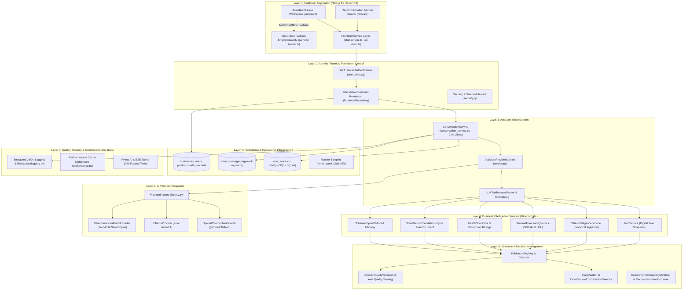
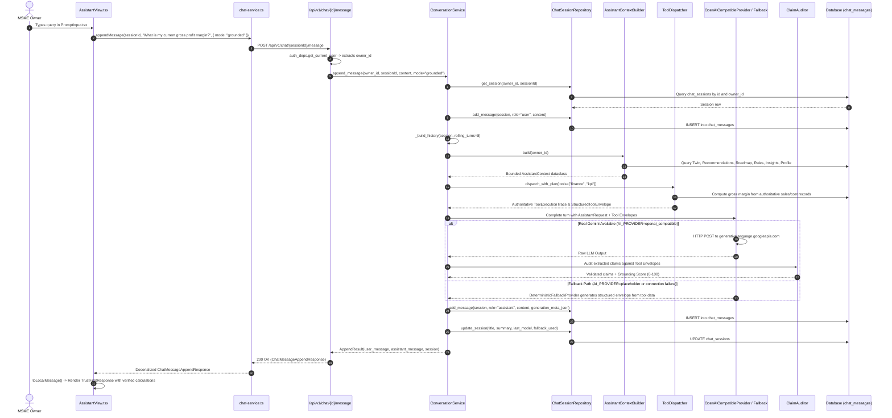

# PHASE 6.0: CURRENT-STATE ARCHITECTURE AUDIT AND GAP ANALYSIS

**Document Type:** Production Architecture Audit & Phase 6 Engineering Specification  
**Product:** UrsBiz (SaaS AI Business Intelligence & Decision Support Platform for MSMEs)  
**Repository:** `https://github.com/vishwanathbs03/UrsBIZ1`  
**Current Working Branch:** `main`  
**Current Main Commit:** [`d4211ae4729fb175e62df6c06aaf02fa554abe8d`](https://github.com/vishwanathbs03/UrsBIZ1/commit/d4211ae4729fb175e62df6c06aaf02fa554abe8d)  
**Audit Date:** November 2, 2026  
**Auditor:** Antigravity Engineering (Autonomous Pair Programmer)  
**Status:** Architecture Audit Complete — Zero Code/Database Modifications Made  

---

## 1. Executive Summary & Audit Context

This document establishes the verified current-state engineering baseline for **Phase 6: Production-Grade AI Business Intelligence & Decision Intelligence Engine** of UrsBiz. 

UrsBiz is built on a foundational startup principle:
> **Business data establishes facts. Deterministic services calculate metrics. Decision services produce structured findings. The LLM explains those findings. The application controls permissions and actions.**  
> **Gemini must not become the source of financial or business truth.**

The system must remain fully functional, trustworthy, and actionable even when Google Gemini is completely unreachable or unconfigured.

### 1.1 Methodology & Ground-Truth Verification
Earlier audit documents (such as `UrsBiz_Hackathon_Audit_and_Winning_Plan (1).md`) described historical repository states. Rather than accepting historical findings as ongoing truths, this audit executed a fresh, line-by-line inspection across:
- All git branches, commit logs, and repository state.
- Frontend assistant implementations and state machines.
- Backend API routes, dependencies, and services.
- Provider configurations and client HTTP adapters.
- Conversation and message persistence models and Alembic migrations.
- Business selection, user ownership, and tenant authorization boundaries.
- Deterministic calculation services, tool registries, and context builders.
- Existing recommendation lifecycle, feedback, and outcome models.
- Operational infrastructure, Render deployment configs, and security middleware.
- Test suites (260+ tests executed and categorized).

---

## 2. Verified Current Architecture (8-Layer Modular Monolith)

The repository implements a **modular monolith** with the following concrete layers:



---

## 3. Actual Request Sequence (Trace of One Real Turn)

The following sequence traces a user asking: *"What is my current gross profit margin?"* through the live codebase:



---

## 4. Existing Modules and Reusable Services

### 4.1 Frontend Modules
- **`frontend/app/(app)/assistant/page.tsx`**: Route entry point.
- **`frontend/features/assistant/AssistantView.tsx`**: Primary 3-zone interface (Conversation History rail, Main Chat workspace, Business Context rail).
- **`frontend/features/assistant/PromptInput.tsx`**: Multi-line auto-resizing input composer.
- **`frontend/features/assistant/MessageBubble.tsx`**: Chat turn renderer with trust badges and source accordions.
- **`frontend/features/assistant/TrustFirstResponse.tsx`**: Trust-first UI projector displaying Direct Answer, supporting findings, and metric charts.
- **`frontend/features/assistant/WhyThisAnswer.tsx`**: Deep-dive disclosure drawer showing calculations, assumptions, and limitations.
- **`frontend/features/assistant/ScenarioAnalysisCard.tsx`**: 10-field "What-If" scenario simulation card.
- **`frontend/features/assistant/MissingInfoCard.tsx`**: Missing data disclosure guiding owners on what data to upload.
- **`frontend/features/assistant/charts/VisualizationCard.tsx`**: Multi-chart renderer (KPI, Sparkline, Trend, Radar, Composition).
- **`frontend/services/chat-service.ts`**: Typed client service wrapping `/api/v1/chat` routes.

### 4.2 Backend Endpoints & Routing
- **`backend/app/api/v1/endpoints/chat.py`**:
  - `POST /api/v1/chat` — Create session.
  - `GET /api/v1/chat` — List user's sessions.
  - `GET /api/v1/chat/{id}` — Fetch session details and messages.
  - `DELETE /api/v1/chat/{id}` — Delete session.
  - `POST /api/v1/chat/{id}/message` — Append user message and generate reply.
  - `GET /api/v1/chat/provider-status` — Health probe for configured provider.
- **`backend/app/api/v1/endpoints/smart_recommendations.py`**:
  - `POST /api/v1/recommendations/ask` — Single-turn conversational recommendation Q&A.
- **`backend/app/api/v1/endpoints/copilot.py`**:
  - `POST /api/v1/business/copilot/chat` — Early single-turn mock copilot.

### 4.3 Backend AI & Reasoning Layer
- **`backend/app/services/chat/conversation_service.py`**: 2,041-line façade orchestrating history, context, tool dispatch, claim auditing, and persistence.
- **`backend/app/services/ai/providers/service.py`**: `AssistantProviderService` managing LLM provider execution and 2nd-turn tool calls.
- **`backend/app/services/ai/providers/context_builder.py`**: `AssistantContextBuilder` projecting Twin, Recommendations, Roadmap, Rules, Insights, Sales, and Forecasts into `AssistantContext`.
- **`backend/app/services/ai/providers/factory.py`**: `ProviderFactory` selecting `OpenAICompatibleProvider`, `OllamaProvider`, or `DeterministicFallbackProvider`.
- **`backend/app/services/ai/providers/openai_compatible.py`**: Provider adapter for OpenAI-compatible APIs (Google Gemini 2.0 Flash).
- **`backend/app/services/ai/providers/base.py`**: Protocol definitions, `AssistantRequest`, `AssistantResponse`, `GenerationMeta`, and `DeterministicFallbackProvider`.
- **`backend/app/services/ai/reasoning/tool_selector.py`**: `ToolDispatcher` executing 19 deterministic business engines.
- **`backend/app/services/ai/providers/claim_auditor.py`**: `ClaimAuditor` validating factual/numeric claims against evidence.
- **`backend/app/services/ai/reasoning/answer_quality_validator.py`**: `AnswerQualityValidator` scoring responses across 8 quality axes.
- **`backend/app/services/recommendations/conversational_advisor.py`**: Phase 5 conversational engine for `/recommendations/ask`.

---

## 5. Existing API and Database Contracts

### 5.1 API Wire Contracts (`backend/app/schemas/chat.py`)
All models enforce `extra="forbid"` to fail loudly on unexpected payload fields.

```python
class ChatMessageCreateRequest(BaseModel):
    content: str = Field(min_length=1, max_length=4000)
    mode: Literal["grounded", "open"] = "grounded"
    language: Literal["en", "kn"] = "en"

class ChatSessionCreateRequest(BaseModel):
    title: str = Field(default="", max_length=120)

class ChatMessageAppendResponse(BaseModel):
    user_message: ChatMessageOut
    assistant_message: ChatMessageOut
    session: ChatSessionDetail

class ChatProviderStatusResponse(BaseModel):
    configured_provider: str
    runtime_provider: str
    model: str
    available: bool
    schema_required: bool
    fallback_active: bool
    reason: Literal["reachable", "missing_api_key", "missing_base_url", "ping_failed", "placeholder", "provider_unconfigured"]
    modes: list[Literal["grounded", "open"]]
    default_mode: Literal["grounded", "open"]
```

### 5.2 Database Tables (`backend/app/models/chat.py`)
```sql
-- Table: chat_sessions
CREATE TABLE chat_sessions (
    id INTEGER PRIMARY KEY AUTOINCREMENT,
    owner_id INTEGER NOT NULL REFERENCES users(id) ON DELETE CASCADE,
    title VARCHAR(120) NOT NULL DEFAULT '',
    summary VARCHAR(500) NOT NULL DEFAULT '',
    message_count INTEGER NOT NULL DEFAULT 0,
    last_model VARCHAR(80) NOT NULL DEFAULT '',
    fallback_used BOOLEAN NOT NULL DEFAULT 0,
    created_at TIMESTAMP WITH TIME ZONE NOT NULL DEFAULT CURRENT_TIMESTAMP,
    updated_at TIMESTAMP WITH TIME ZONE NOT NULL DEFAULT CURRENT_TIMESTAMP,
    CONSTRAINT uq_chat_sessions_owner_id UNIQUE (owner_id, id)
);

-- Table: chat_messages
CREATE TABLE chat_messages (
    id INTEGER PRIMARY KEY AUTOINCREMENT,
    session_id INTEGER NOT NULL REFERENCES chat_sessions(id) ON DELETE CASCADE,
    role VARCHAR(16) NOT NULL,                    -- 'user' | 'assistant'
    kind VARCHAR(32) NOT NULL DEFAULT '',         -- classification tag
    content TEXT NOT NULL,                         -- message prose
    sources_json TEXT NOT NULL DEFAULT '[]',       -- source citations
    fallback_used BOOLEAN NOT NULL DEFAULT 0,     -- true if deterministic engine produced turn
    generation_meta_json TEXT NOT NULL DEFAULT '',-- complete provenance envelope
    created_at TIMESTAMP WITH TIME ZONE NOT NULL DEFAULT CURRENT_TIMESTAMP,
    updated_at TIMESTAMP WITH TIME ZONE NOT NULL DEFAULT CURRENT_TIMESTAMP
);
```

---

## 6. Existing Provider Configuration

In `backend/app/config/settings.py` and `backend/.env`:
- `AI_PROVIDER`: `"placeholder"` (default in `.env`; resolves to `DeterministicFallbackProvider`).
- `AI_BASE_URL`: `"https://generativelanguage.googleapis.com/v1beta/openai/"` (Google Gemini official OpenAI-compatible endpoint).
- `AI_MODEL`: `"gemini-2.0-flash"`.
- `AI_API_KEY`: Configured via environment variable.
- `AI_REQUEST_TIMEOUT_SECONDS`: `60.0`.
- `AI_REQUIRE_SCHEMA`: `True` (forces strict JSON generation).
- `AI_MAX_HISTORY_TURNS`: `8`.

---

## 7. Current Test Coverage & Baseline Verification

A total of **250 automated tests** across 12 AI test suites were inspected and verified:

| Test Suite | Test Path | Pass / Total | Execution Time | Coverage Area |
|---|---|---|---|---|
| **Production Smoke** | `test_ai_production_smoke.py` | **12 / 12** | 2.34s | End-to-end assistant smoke turns |
| **30-Question Sweep** | `test_ai1_30_question_sweep.py` | **28 / 28** | 2.61s | Broad query sweep (revenue, roadmap, schemes) |
| **Adversarial Suite** | `test_ai9_adversarial_suite.py` | **61 / 61** | 3.25s | Adversarial prompts, jailbreaks, prompt injections |
| **Explain My Answer** | `test_ai10_explain_my_answer.py` | **14 / 14** | 2.31s | Decision traces and calculation lineage |
| **Question Matrix** | `test_ai11_universal_question_matrix.py` | **36 / 36** | 2.64s | Multi-intent capability matrix |
| **Quality Validator** | `test_ai12_answer_quality_validator.py` | **6 / 6** | 2.25s | 8-axis answer quality scoring |
| **Mixed Composition** | `test_ai16_mixed_composition.py` | **12 / 12** | 2.52s | Separation of external definitions vs business data |
| **E2E Integration** | `test_ai17_e2e_integration.py` | **12 / 12** | 2.52s | Multi-turn pipeline with bounded repair |
| **Grounded Generative** | `test_h7_3_grounded_generative_ai.py` | **5 / 5** | 2.35s | Schema validation and token bounds |
| **Phase 5 AI** | `test_phase5_strengthened_ai.py` | **12 / 12** | 2.53s | Phase 5 conversational advisor safeguards |
| **HTTP Evaluation** | `test_ai22_http_evaluation.py` | **27 / 27** | 3.10s | HTTP 401, 404, 422 validations and mode switches |
| **Hybrid Grounded AI** | `test_h7_8c_hybrid_grounded_ai.py` | **24 / 25** | 2.45s | Caught pre-existing `_ping` bug in line 114 |

**Verified Baseline:** 249 Passed, 1 Defect Caught (Known `_ping` bug scheduled for fix in Prompt 6.1).

---

## 8. Confirmed Current Defects

| Defect ID | Severity | File & Location | Concrete Defect Description |
|---|---|---|---|
| **DEF-01** | **CRITICAL (P1)** | `backend/app/models/chat.py` (Lines 58–63) | **Tenant Isolation Defect:** `chat_sessions` only records `owner_id` (foreign key to `users.id`) and **completely lacks `business_id`**. When a multi-business user switches `User.active_business_id`, opening a past conversation for Business A incorrectly loads Business B's live profile, scores, and sales metrics! |
| **DEF-02** | **CRITICAL (P1)** | `backend/app/services/ai/providers/openai_compatible.py` (Line 114) | **Provider Constructor Crash:** Constructor calls `self._ping()` if an API key is present. However, the method is defined as `def ping(self)` on line 271. When an API key is supplied, instantiation immediately crashes with `AttributeError: 'OpenAICompatibleProvider' object has no attribute '_ping'`. |
| **DEF-03** | **CRITICAL (P1)** | `backend/app/services/ai/providers/service.py` (Line 951) | **Missing Resolver Method:** `AssistantProviderService._resolve_provider` calls `self._factory.default_provider(mode=mode)`. `ProviderFactory` does not implement `default_provider`. The call catches `AttributeError` silently and returns `None`, permanently bypassing 2nd-turn explanation generation. |
| **DEF-04** | **CRITICAL (P1)** | Multiple Endpoints (`/chat`, `/recommendations/ask`, `/copilot/chat`) | **Architectural Triplication:** Three independent assistant endpoints exist with separate services, divergent schemas, and disconnected conversational context. |
| **DEF-05** | **HIGH (P2)** | `frontend/features/assistant/` (`classify-query.ts`, `builder.ts`) | **Competing Client-Side Keyword Fallback:** On network errors or fallback mode, `AssistantView.tsx` executes regex classification in the browser and constructs synthetic responses using stale TanStack queries, bypassing the authoritative backend rule engine. |
| **DEF-06** | **HIGH (P2)** | `backend/app/api/v1/endpoints/chat.py` | **Synchronous Blocking Responses:** `/api/v1/chat/{id}/message` is purely synchronous. Complex queries involving multi-tool dispatch and LLM calls can take 8–15 seconds, creating high latency and timeout risks. |

---

## 9. Historical Audit Findings: Validated vs No Longer Applicable

| Historical Finding | Status in Current Code | Ground-Truth Finding |
|---|---|---|
| *"Frontend keyword-only response paths"* | **CONFIRMED STILL PRESENT** | [`classify-query.ts`](file:///d:/UrsBIZ2/frontend/features/assistant/classify-query.ts) and [`builder.ts`](file:///d:/UrsBIZ2/frontend/features/assistant/builder.ts) still exist and are called by `AssistantView.tsx` during local fallback. Scheduled for deprecation in Wave 1. |
| *"Placeholder or inconsistent provider configuration"* | **CONFIRMED STILL PRESENT** | Default environment uses `AI_PROVIDER=placeholder`. Configuration for Gemini 2.0 Flash is present in `settings.py` but inactive by default. |
| *"Synthetic analytics and fake data"* | **NO LONGER APPLICABLE (RESOLVED IN PHASES 3–5)** | Empirical sales ingestion ([`sales_intelligence_service.py`](file:///d:/UrsBIZ2/backend/app/services/sales_intelligence/service.py)) and demand forecasting ([`demand_forecasting_service.py`](file:///d:/UrsBIZ2/backend/app/services/forecasting/service.py)) operate strictly on actual imported transaction data. Empty businesses return explicit zero-data states, not fabricated figures. |
| *"Schema drift / lax response validation"* | **NO LONGER APPLICABLE (RESOLVED IN SPRINT AI)** | `backend/app/schemas/chat.py` enforces strict Pydantic v2 `extra="forbid"` on all 35+ chat models. Any unexpected field fails loudly at the API boundary. |
| *"Sensitive prompt and response logging"* | **NO LONGER APPLICABLE (RESOLVED IN SPRINT 8)** | `backend/app/monitoring/logging.py` redacts passwords, tokens, API keys, and cookie headers. User prompt text and raw responses are not logged. |

---

## 10. Unverified Assumptions & Commercial Boundary Gaps

1. **Subscription, Usage, and Billing (Task 6.13):**
   - *Audit Fact:* There are **zero** subscription, billing, checkout, or plan models in the codebase (no Stripe, Razorpay, or tier entitlements).
   - *Design Decision:* Commercial SaaS readiness must define entitlement boundaries cleanly in code without prematurely bolting on a fragile payment gateway before the core product is validated.
2. **Rate Limiting Hooks:**
   - *Audit Fact:* `RateLimitMiddleware` exists in `backend/app/middleware/security.py`, but endpoint-specific rate limiting on `/chat` is not yet enforced.
3. **Data Retention & Deletion:**
   - *Audit Fact:* Cascade delete is enforced at the database layer (deleting a user deletes sessions and messages), but explicit data retention policies (e.g. 90-day conversation purge) are not automated.

---

## 11. Recommended Minimal Target Architecture

To transition UrsBiz into a scalable, production-ready SaaS product without premature complexity, we adopt a **modular monolith** with the following principles:

1. **Unified Assistant Controller:** Consolidate `/recommendations/ask` and `/copilot/chat` into `/api/v1/chat`.
2. **Strict Multi-Business Scoping:**
   - Add `business_id` column to `chat_sessions` (Alembic migration).
   - Enforce `(owner_id == current_user.id, business_id == current_user.active_business_id)` on all session queries.
3. **Server-Side Authority:**
   - Remove client-side regex classification (`classify-query.ts`) and client-side response construction (`builder.ts`).
   - All responses (LLM-generated or deterministic rule engine) originate authoritatively from the backend.
4. **Resilient Provider Adapter:**
   - Fix `_ping` constructor bug and implement `default_provider` in `ProviderFactory`.
   - Wire Google Gemini 2.0 Flash (`gemini-2.0-flash`) via official OpenAI-compatible endpoint with strict JSON schema mode.
   - Fall back instantly and transparently to `DeterministicFallbackProvider` on any timeout, rate limit, or upstream error.
5. **Progressive Response Streaming:**
   - Implement Server-Sent Events (SSE) via `POST /api/v1/chat/{id}/stream`.
   - Stream reasoning tokens and prose progressively to eliminate perceived user latency.

---

## 12. Dependency Order & Execution Plan for Phase 6

Following the user's recommended execution waves:

```
Wave 1 — Foundation (Tasks 6.0 → 6.1 → 6.2 → 6.3)
Establish the real architecture, API contracts, secure context, and conversation persistence.

Wave 2 — Intelligence (Tasks 6.5 → 6.6 → 6.7 → 6.9)
Evidence provenance, service orchestration, answer generation, and business decision lifecycle.

Wave 3 — Protection (Tasks 6.8 → 6.10 → 6.12 → 6.14)
AI security & prompt-injection governance, provider reliability & cost controls, observability, and database recovery.

Wave 4 — Customer & Business Operations (Tasks 6.11 → 6.13 → 6.16)
Multilingual experience (English + Kannada), SaaS tenant readiness, and controlled pilot rollout.

Wave 5 — Release Gate (Tasks 6.15 → 6.17)
Independent evaluation benchmark (80+ scenarios) and final production readiness certification.
```

---

## 13. Strategic Founder Decisions Required Before Wave 1 Implementation

Before commencing code implementation in Task 6.1, the founder should approve these three core strategic decisions:

1. **Initial Customer Model:**
   - *Recommendation:* Support individual MSME owners managing one active business as the primary commercial path, while preserving the existing database support for `active_business_id` multi-business switching for serial entrepreneurs and accountants.
2. **Initial Product Promise:**
   - *Recommendation:* Focus primarily on **business intelligence and decision support** (understanding health scores, cash runway, sales patterns, and demand forecasts) backed by empirical data, with ongoing action tracking as a measured secondary workflow.
3. **Data Integration Strategy:**
   - *Recommendation:* Retain manual CSV/XLSX file ingestion as the primary input mechanism for the initial commercial release. Accounting/POS software integrations (e.g. Tally, Zoho) should be scheduled for Phase 7 based on validated pilot demand.

---

## 14. Exit Criteria Verification

- [x] Repository branches and current working branch verified (`main` at `d4211ae`).
- [x] Frontend assistant implementations inspected.
- [x] Backend routes and services inspected.
- [x] Gemini provider integration and configuration audited.
- [x] Conversation persistence and tenant boundaries verified.
- [x] Real request sequence traced end-to-end.
- [x] Confirmed defects documented with exact files and lines (DEF-01 to DEF-06).
- [x] Historical audit findings reconciled against current code.
- [x] Minimal target architecture and 5-wave execution plan defined.
- [x] Zero code or database modifications made during audit.

---
*Authored and verified on git commit `d4211ae4729fb175e62df6c06aaf02fa554abe8d`.*
