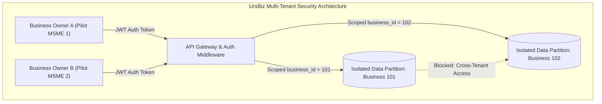

# UrsBiz Controlled MSME Pilot — Data Privacy, Security & Isolation Policy

**Document ID**: `UB-PILOT-PRIVACY-2026-V1`  
**Target Audience**: Pilot Participants, MSME Owners, Compliance Officers  

---

## 1. Executive Summary

UrsBiz treats enterprise sales data and business records as strictly confidential. This document explains in clear, plain language how your business data is collected, stored, isolated, processed, and deleted during the controlled pilot.

---

## 2. Core Privacy Principles

1. **Data Minimization**: We only ask for information strictly required to generate business intelligence, demand forecasts, and recommendations. We do not ask for personal customer identities, bank account details, or payment card information.
2. **Informed Consent**: No data is uploaded or processed without your explicit, signed consent.
3. **Purpose Limitation**: Your data is used exclusively to power your business dashboard and evaluate pilot feasibility. It will never be sold, rented, or repurposed for marketing, advertising, or credit profiling.
4. **Tenant Isolation**: Your data is completely separated from every other business on UrsBiz. No competitor, peer, or other pilot participant can view your data.
5. **No AI Model Training on Your Data**: Your proprietary sales transactions, margins, and customer patterns are **never** used to train public foundation artificial intelligence models.

---

## 3. Multi-Tenant Architectural Isolation

UrsBiz employs strict architectural controls to ensure your business data remains isolated:

- **JWT Authentication & Authorization**: Every API request is verified using cryptographically signed JSON Web Tokens (JWT).
- **Enforced Business Scoping**: All database queries enforce strict filtering on `business_id`. Attempting to access or modify records belonging to another `business_id` results in immediate `403 Forbidden` rejection and an auditable security event.
- **Role-Based Permissions**: Only authenticated users linked to your specific business can view your sales metrics, forecasts, and recommendations.

---

## 4. How Artificial Intelligence (Gemini) Processes Your Data

UrsBiz uses Google Gemini API to generate natural language explanations and step-by-step action plans for recommendations:

- **Context-Bounded Generation**: The engine transmits only the specific summarized context needed to explain a recommendation (e.g. "Customer repeat rate is 18%, down from 24%").
- **Zero Data Retention for Training**: UrsBiz connects to Gemini via Google Cloud enterprise API endpoints where customer prompt data is **not retained or used to train Google's models**.
- **Deterministic Offline Fallback**: If internet connectivity is interrupted or AI services are unavailable, UrsBiz automatically switches to verified, deterministic offline templates without transmitting any data over the network.
- **Hallucination Guardrails**: All numerical figures in AI explanations are audited against ground-truth database metrics using UrsBiz's built-in `AIAnswerEvaluator` before being displayed.

---

## 5. Data Storage, Encryption & Retention

| Data Layer | Security Measure | Storage Duration |
| :--- | :--- | :--- |
| **In Transit** | TLS 1.3 encryption for all browser-to-server traffic. HTTPS enforced. | Ephemeral |
| **Database at Rest** | AES-256 encrypted PostgreSQL database hosted in secure cloud data centers. | Retained for 4-week pilot + 30-day export window |
| **File Storage** | Temporary uploaded CSV/XLSX files are stored in secure memory during ingestion, processed into database rows, and not left exposed in public directories. | Ingestion memory cleared immediately |
| **Cryptographic Provenance** | Every calculated metric is paired with a SHA-256 integrity hash to detect tampering or corruption. | Stored with metric records |

---

## 6. Data Deletion & Export Procedure

You retain full ownership of your data at all times:

1. **Data Export**: At any point during or after the pilot, you may request a complete export of your raw sales transactions and generated recommendations in standard CSV/JSON formats.
2. **Right to Immediate Deletion**: You can request the total erasure of your business account by emailing `privacy@ursbiz.internal` or notifying your pilot coordinator.
3. **Deletion Execution SLA**: Upon receiving your deletion request:
   - Your account is immediately deactivated.
   - All sales transactions, business profile details, recommendation records, and uploaded files are purged from active databases within **48 hours**.
   - A formal written Confirmation of Erasure will be issued to you.

---

## 7. Public Reporting & Synthetic Benchmark Separation

- **Strict Anonymization**: Any public whitepapers, engineering documentation, or hackathon presentations will report only aggregated, anonymized statistics (e.g. "Participating MSMEs saw an average 15% increase in recommendation acceptance").
- **Synthetic Data Labeling**: UrsBiz maintains strict separation between synthetic test datasets used in development and actual real-world pilot data. Synthetic data is always marked with `is_synthetic: true` to prevent any confusion.

---

## 8. Questions & Contact

For any data protection inquiries, security questions, or deletion requests, please contact:

**UrsBiz Data Protection Officer**  
Email: `privacy@ursbiz.internal` / `dpo@ursbiz.com`  
Platform Support: `https://ursbiz-frontend.onrender.com/`
