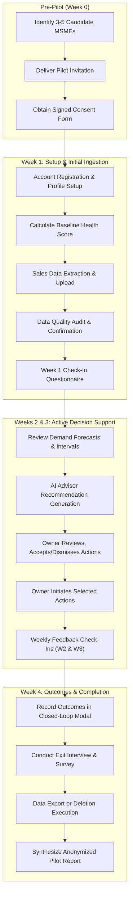

# UrsBiz Controlled MSME Pilot — Operational Workflow & Protocol

**Document ID**: `UB-PILOT-WORKFLOW-V1`  
**Execution Window**: 4-Week Structured Pilot  
**Target Group**: 3 to 5 Selected MSMEs  

---

## 1. Operational Timeline & Cadence

---

## 2. Weekly Operational Breakdown

### Week 0: Recruitment & Consent
- **Deliverables**: Send `01_PILOT_INVITATION.md`, collect signed `02_PARTICIPANT_CONSENT_FORM.md`.
- **Coordinator Responsibilities**: Verify business meets selection criteria (3+ months historical sales, clear product items, authorized decision-maker).
- **Milestone Exit**: 3 to 5 fully executed consent agreements filed.

### Week 1: Platform Onboarding & First Ingestion
- **Deliverables**: Complete `03_BUSINESS_ONBOARDING_CHECKLIST.md`, ingest first sales dataset using `sales_upload_template.csv` or native export, administer `09_WEEKLY_FEEDBACK_QUESTIONNAIRE.md` (Week 1).
- **Coordinator Responsibilities**: Guide owner through account registration, business profile setup, and initial spreadsheet upload. Troubleshoot any column mapping issues.
- **Milestone Exit**: Each business profile created, baseline health score recorded, at least 1 valid sales dataset ingested.

### Week 2: Demand Forecasting & Recommendation Exploration
- **Deliverables**: Walkthrough of Demand Forecasting and AI Advisor; administer `09_WEEKLY_FEEDBACK_QUESTIONNAIRE.md` (Week 2).
- **Coordinator Responsibilities**: Ensure participant understands prediction intervals (P10–P90) and evaluation metrics. Guide owner on reviewing AI recommendation evidence and action plans.
- **Milestone Exit**: Participant reviews generated recommendations; takes at least one lifecycle action (accept or dismiss).

### Week 3: Active Implementation & Signal Monitoring
- **Deliverables**: Monitor ongoing recommendations; check for business signal changes; administer `09_WEEKLY_FEEDBACK_QUESTIONNAIRE.md` (Week 3).
- **Coordinator Responsibilities**: Support participant in executing accepted recommendations. Document any bugs via `08_ISSUE_REPORTING_FORM.md`.
- **Milestone Exit**: Participant moves at least one recommendation to "In Progress" or "Completed".

### Week 4: Outcome Evaluation, Exit Interview & Wrap-Up
- **Deliverables**: Complete `10_PILOT_COMPLETION_QUESTIONNAIRE.md`; offer data export or schedule deletion.
- **Coordinator Responsibilities**: Conduct 20-minute structured interview with owner. Document before-and-after business metrics, qualitative feedback, and net promoter score.
- **Milestone Exit**: All tracking records finalized; data retention or deletion confirmed in writing.

---

## 3. Roles and Responsibilities

| Role | Primary Responsibilities |
| :--- | :--- |
| **Participant (Business Owner / Manager)** | Provide historical sales data, review platform insights weekly, test recommendation workflows, and complete 3 short weekly surveys + 1 exit interview. |
| **Lead Pilot Coordinator** | Primary point of contact for participant. Leads onboarding walkthrough, monitors upload quality, and conducts weekly check-ins. |
| **Platform Support Engineer** | Triages and resolves bugs logged via `08_ISSUE_REPORTING_FORM.md` within 24 hours. Monitors backend server availability and database backups. |
| **Data Protection Officer (DPO)** | Ensures multi-tenant isolation, oversees safe deletion requests within 48 hours, and audits data anonymization in reports. |

---

## 4. Key Performance Indicators (KPIs) for the Pilot

To evaluate real-world pilot success objectively, UrsBiz will measure:

1. **Onboarding Completion Rate**: Percentage of enrolled MSMEs that successfully complete profile setup and initial sales data ingestion (Target: $\ge 80\%$).
2. **Data Ingestion Quality**: Average automated data quality score across all uploaded files (Target: $\ge 85\%$).
3. **Weekly Active Engagement**: Percentage of participants accessing the platform at least twice per week (Target: $\ge 70\%$).
4. **Recommendation Action Rate**: Percentage of presented recommendations actively accepted or dismissed with reasons (Target: $\ge 50\%$).
5. **AI Explanation Accuracy**: Percentage of AI-generated action plans verified as grounded and factually accurate by business owners (Target: $\ge 90\%$).
6. **Overall Participant Satisfaction**: Average CSAT score ($\ge 4.0 / 5.0$) and Net Promoter Score ($\ge +40$).
